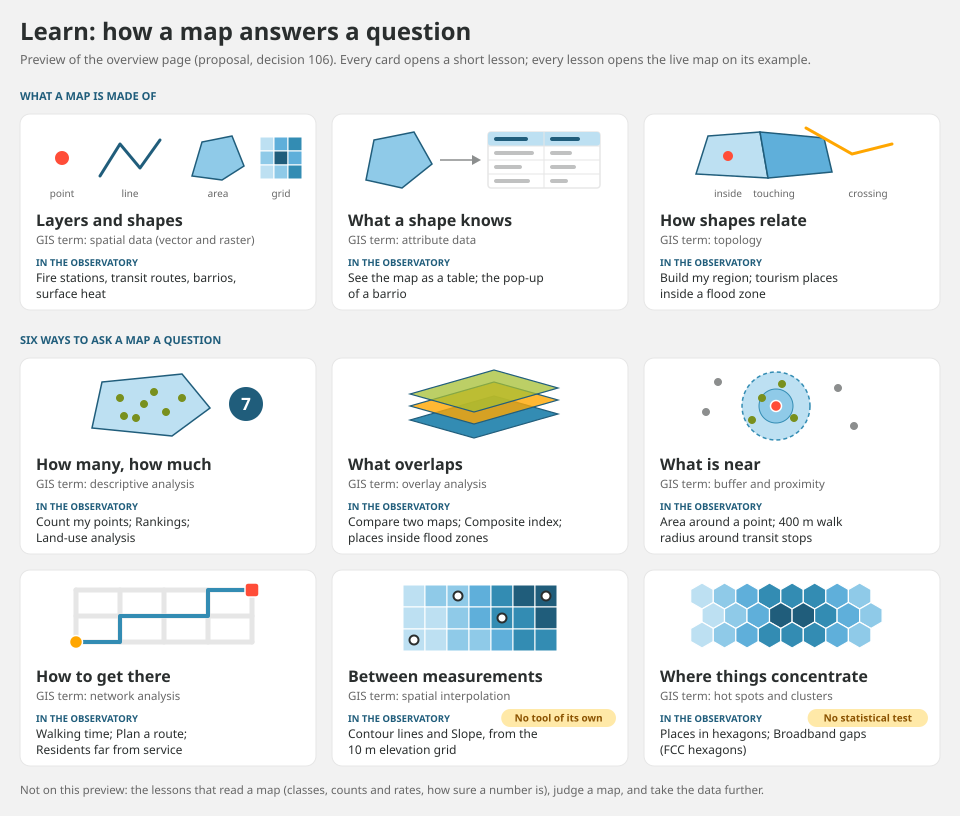

# Proposal: Learn, a section that teaches maps and spatial analysis with the observatory's own data and tools

Date: 2026-11-14. Status: **approved by Francis on 2026-11-14 ("Approve, start step 1"): decision 106 (a) to (h) as proposed. Step 1 is being built on branch `learn/first-lessons`.** This pull request changes no page and builds no data.

**In one paragraph.** Francis asked on 2026-11-14 for an education section that teaches people about mapping, mapping tools and analysis, with visual explanations like a "Spatial data analysis in GIS" infographic he shared, and with the observatory's real data and tools as the examples. Checked against main (`023d38b`): the observatory already has what a course needs as examples (**25 map tools, 48 layers with a help text, 434 glossary terms**), but nothing that teaches the ideas behind them or the order in which to learn them. Of the nine concepts in the infographic, **seven have a real tool or layer to teach with; two (spatial interpolation, hot spots) have no tool of their own** and are taught with what exists. The proposal is a **Learn** page ("Aprende"): 17 short lessons in four parts. Each lesson has a diagram drawn for the observatory, a button that opens the live map on a real example, and its terms linked to the glossary. It is not a general GIS course: others teach that well, and the lessons link to them.

The preview (`docs/analysis/learn-2026-11/preview.svg`, drawn by `make_preview.py`) shows the overview page for the nine concepts of the infographic. It is not a page of the site, and its diagrams carry no figure of Puerto Rico.

## 1. What a GIS expert would build, and would not

**Would build:**

- **Lessons on the live map.** People learn a method when they use it on a place they know. Every lesson opens the real map with the right layer or tool already on.
- **One question per lesson, 5 to 10 minutes.** The title is the question in plain words ("What is near?"). The GIS term ("buffer") comes second, with its glossary pop-up.
- **Three levels.** Read a map, then ask it a question, then judge what it can and cannot tell you. Most map mistakes are made at the third level.
- **Help at the point of need.** A person looking at a legend should reach the lesson that explains it in one click.
- **A kit for a room.** FPR teaches in workshops. A printable guide lets a facilitator run a session with the same lessons.

**Would not build:**

- **A general GIS textbook or a video course.** They exist, they are free, and they go out of date. The lessons link to them.
- **Accounts, certificates or tracked quizzes.** The observatory has no accounts and stores nothing about a visitor.
- **A copy of the shared infographic.** Its source and licence are unknown, and it has an error ("totalar."). It is the model for the layout only.

## 2. What was checked (2026-11-14, main `023d38b`)

| Item | Result |
|---|---|
| Map tools (Tools › Map tools, `site/index.html`) | **25 tools** in five groups. Each row opens an existing tool. |
| Layers (Explore › Map layers) | **48 layers** have a help text behind a "?" (`js/help.js`, `js/facilities.js`). A help text says what a layer is; it does not teach a method. |
| Glossary (`dictionary_src/glossary.json`) | **434 terms**, each in English and Spanish with a source. Already there: polygon, layer, point-in-polygon, buffer, zonal statistics, dissolve, travel-time area, hexagon grid, choropleth map, class break, quantile, equal intervals, natural breaks, rate, per capita, margin of error, sampling error, statistically significant, suppression, "counted, not drawn", pooled rate, contour line, slope, composite index, bivariate map, correlation. **Missing:** raster, vector, attribute, topology, overlay, spatial join, network analysis, interpolation, hot spot, map projection, map scale, legend, GIS, QGIS, and the two classic cautions of section 4, part C. |
| Guidance today | About › "Start here: six steps" explains how to use the site. Nothing explains how to read or question a map. |
| Links that reopen a view (`docs/view-state.md`) | A link can turn on layers (`l=`), shade a dataset with its classes (`e=`), open a composite index (`ix=`), a scenario (`sc=`), places as hexagons (`pv=`), a sea level (`slr=`), a base map (`bm=`) and a workbench view (`wb=`, `wc=`). **No key opens a map tool** such as Area around a point or Walking time. Step 1 adds one. |
| Classes (`js/core/classify.js`) | Quantile, equal intervals, natural breaks (Jenks) and manual breaks, chosen in the Analysis tab. A lesson can show the same numbers three ways with the real engine. |
| Counts and rates (`js/core/normalize.js`) | As published, per 1,000 residents, per km², per resident, share of Puerto Rico, location quotient, index. |
| How sure a number is (`js/core/reliability.js`) | Flags a survey estimate whose margin of error is above 30% of the estimate, and a rate built on fewer than 10 counted. |
| Hexagons (`js/core/hexbin.js`) | Counts points in hexagons of equal area (Lambert azimuthal equal-area projection). A count per hexagon is a density. |
| Interpolation | None in the site or the build as a tool. Decision 93 (c) left IDW and kriging out: Puerto Rico has few sample points for most variables, and a smooth surface looks more certain than it is. |
| Hot-spot test | None. Nothing in the site or the build tests whether a cluster is statistically significant (no Getis-Ord, no Moran). |
| Page weight (`budget.py` on an LF copy) | Map scripts **190.2 of 250 KB**. Most Knowledge Area pages load 29 to 41 KB of scripts (Housing and WCRP load more). A Learn page fits a budget of that size. |
| Knowledge registry (`knowledge_src/items.json`) | 14 items of four kinds (study, analysis, program tool, index profile). A lesson is none of these, so Learn keeps its own short registry. |

## 3. The infographic's nine concepts against the observatory

| Concept in the infographic | The question, in plain words | Real example in the observatory | Status |
|---|---|---|---|
| Spatial data (vector and raster) | What is a map made of? | Fire and EMS stations (points), Transit routes (lines), Barrios (areas), Surface heat and Slope (grids) | Have it |
| Attribute data | What does a shape know? | See the map as a table; the pop-up of a barrio or a municipio | Have it |
| Topology | How do shapes relate? | Build my region (merges neighbours); tourism places inside a flood zone | Have it |
| Descriptive analysis | How many, how much? | Count my points; Place › Rankings; Land-use analysis | Have it |
| Overlay analysis | What overlaps? | Share of tourism places in a FEMA flood zone; Compare two maps; two shaded layers as one bivariate map; Composite index; Study areas | Have it |
| Buffering and proximity | What is near? | Area around a point; 400 m walk radius around transit stops | Have it |
| Network analysis | How do I get there? | Walking time; Plan a route; Residents far from service | Have it |
| Spatial interpolation | What is between two measurements? | Contour lines and Slope, made from the USGS 10 m elevation grid; Rainfall and Groundwater levels, shown as stations | **No tool of its own** |
| Hot spot and cluster analysis | Where do things concentrate? | Places in hexagons; Broadband gaps (FCC hexagons) | **No statistical test** |

**The two gaps are lessons, not holes.**

- **Interpolation.** The lesson shows the Rainfall and Groundwater stations as the points they are, and explains why the observatory does not paint a smooth surface between them. It then shows two surfaces that are sound because they start from a full grid of measurements: Contour lines and Slope.
- **Hot spots.** The lesson uses Places in hexagons to show where things concentrate, and teaches the difference between "many here" and "more than chance would put here". A statistical test would be a new tool and its own decision (section 8).

## 4. The lessons: 17 in four parts

**Part A. Read a map (6)**

| # | Lesson | Teaches | Example in the observatory |
|---|---|---|---|
| A1 | Layers and shapes | Points, lines, areas and grids; vector and raster | Fire stations, Transit routes, Barrios, Surface heat |
| A2 | What a shape knows | Attributes: the table behind the map | See the map as a table |
| A3 | How shapes relate | Inside, touching, crossing | Build my region; places inside a flood zone |
| A4 | Colours and classes | The same numbers drawn three ways: quantile, equal intervals, natural breaks | A dataset of the Analysis tab, with each method |
| A5 | Counts and rates | A count shows where people are; a rate shows something about the place | The same dataset as published and per 1,000 residents |
| A6 | How old, how sure | The year of a figure, the margin of error, small numbers | A barrio estimate that the map flags |

**Part B. Ask a question (6): the six types of analysis in the infographic**

| # | Lesson | GIS term | Example in the observatory |
|---|---|---|---|
| B1 | How many, how much | Descriptive analysis | Count my points; Rankings; Land-use analysis |
| B2 | What overlaps | Overlay analysis | Places in a flood zone; Compare two maps; Composite index |
| B3 | What is near | Buffer and proximity | Area around a point; 400 m walk radius |
| B4 | How to get there | Network analysis | Walking time; Plan a route; Residents far from service |
| B5 | Between measurements | Spatial interpolation | Rainfall and Groundwater stations; Contour lines; Slope |
| B6 | Where things concentrate | Hot spots and clusters | Places in hexagons; Broadband gaps |

**Part C. Judge a map (3)**

| # | Lesson | Teaches | Example in the observatory |
|---|---|---|---|
| C1 | The size of the area changes the answer | The same data by municipio, barrio and hexagon tell different stories (the modifiable areal unit problem) | A dataset published by municipio and by barrio |
| C2 | Two patterns that match are not a cause | Correlation; what is true of an area is not true of each person in it (the ecological fallacy) | Two shaded layers as a bivariate map |
| C3 | What a map leaves out, and why | Privacy and licences: counted, not drawn; suppression; withheld names | A layer that counts sites without drawing them |

**Part D. Take it further (2)**

| # | Lesson | Teaches | Example in the observatory |
|---|---|---|---|
| D1 | Bring your own data | Your points and areas on the map, kept in your browser | Count my points; Draw an area; Study areas |
| D2 | From the observatory to QGIS | Download a file, open it in QGIS (free), join a table to barrios by GEOID | A published data file and its dictionary entry |

## 5. What a lesson is made of

1. **The question**, as the title.
2. **A diagram** of the idea, in the style of the preview.
3. **In the observatory:** the same idea on real data, with real numbers.
4. **Try it on the map:** one or two buttons that open the live map on that example.
5. **Watch out:** the one mistake people make most with this method.
6. **Terms and next step:** the glossary terms of the lesson, and one outside source to go further.
7. **Check yourself** (if approved, section 9 (f)): two or three questions answered on the page.

About 300 words in each language.

## 6. How the visuals are made

- **Drawn for the observatory.** Each diagram is an SVG in the site's colours (`docs/palettes.md`), with its words in English and Spanish, a text alternative for screen readers, and a size that reads at 390 px and on paper.
- **An overview laid out like the infographic.** One card per lesson: diagram, question, GIS term, and the tools it uses.
- **Three small demos where the idea needs movement:** switch the class method (A4), switch count and rate (A5), change the distance of a ring (B3). They reuse `core/classify.js`, `core/normalize.js` and `core/study.js` on published data. No new engine.
- **Real numbers come from a script.** `learn.py` computes every figure a lesson quotes from the published data files and writes `site/data/learn.json`; a test fails when a lesson's figure is stale. No number is typed by hand.

## 7. The steps, first visible result first

Effort as in `docs/proposal-2026-10.md`: **S** under 1 day, **M** 2-4 days, **L** 1-2 weeks. Each step is its own pull request.

### Step 1. The Learn page and three lessons (M). **Shows on the site first.**
- `learn.html` with the overview cards and lessons **A1 Layers and shapes**, **B3 What is near** and **A5 Counts and rates**. A card appears only for a lesson that is written (the rule of decision 97 (d)).
- The registry `learn_src/lessons.json` (each lesson's part, title, terms, tools, layers and status) and `learn.py`, which checks it and writes the lessons' figures.
- A one-time link key that opens a map tool, read once like `wb=`, so "Try it on the map" can open Area around a point.
- "Learn" / "Aprende" in the top bar of every page, and a line in About › Start here.
- Glossary terms: raster, vector, GIS, legend, map scale.

### Step 2. The other five ways to ask (M-L).
- Lessons B1, B2, B4, B5 and B6. The overview then covers all six types of analysis in the infographic.
- **Help at the point of need:** the "?" of a layer and each row of Map tools link to their lesson, and a glossary pop-up links to the lesson that teaches its term. The links are generated from the registry.
- Glossary terms: overlay, spatial join, network analysis, interpolation, hot spot.

### Step 3. The rest of Read a map (M).
- Lessons A2, A3, A4 and A6, with the class-method demo. Glossary terms: attribute, topology.

### Step 4. Judge a map (M).
- Lessons C1, C2 and C3. Glossary terms: modifiable areal unit problem, ecological fallacy.

### Step 5. Take it further, and the workshop kit (M).
- Lessons D1 and D2. Glossary terms: QGIS, map projection.
- A printable facilitator guide for a 60 to 90 minute session, in Spanish and English: the plan of the session, the lessons to use, the exercises on the live map and a one-page handout.

## 8. What is not proposed, and why

- **An interpolation tool (IDW, kriging).** Decision 93 (c) stands. Lesson B5 teaches why.
- **A hot-spot tool.** A test such as Getis-Ord Gi* needs choices (the neighbourhood, the correction for many tests) that are easy to get wrong and hard to explain. If the lessons show a demand for it, it is proposed on its own, with its method written first.
- **Lessons as Knowledge Area items.** The Knowledge Area holds FPR's research and program tools. A lesson is neither, so Learn has its own page and registry; the Knowledge home page links to it.
- **Video, accounts, certificates, tracked quizzes** (section 1).

## 9. Decisions for Francis (106)

- **(a) Name and place.** "Learn" / "Aprende", its own page `learn.html`, and a fifth button in the top bar of every page (Map, 3D + Time, Knowledge, Data dictionary, Learn). The map's tabs (Explore, Place, Tools, About: decision 81) do not change. The other option is a group inside the Knowledge home page.
- **(b) The lessons and the order.** The 17 lessons of section 4 and the five steps of section 7, with A1, B3 and A5 first.
- **(c) The visuals.** Diagrams drawn for the observatory in the style of the preview. The shared infographic is the model for the layout and is not reused.
- **(d) The two gaps.** Interpolation and hot spots are taught with what exists. No new tool now.
- **(e) Publication.** The Spanish is published with each lesson and not held for Compliance: a lesson is teaching material, not grant work. To keep it so, no lesson uses as its example a dataset whose text is held (`i18n_src/held_for_review.json`). The page keeps the "In review" marker, the AI notice and `noindex` until Francis takes them off, as in decision 103.
- **(f) Check yourself.** Two or three questions per lesson, answered on the page. Nothing is stored or sent.
- **(g) What a lesson may say.** Methods and facts only. A lesson recommends no policy and judges no agency, and no example draws or names a private home (lesson C3 explains the rule).
- **(h) Review before the marker goes.** A native Spanish reader on the team reads each lesson, and a person who teaches workshops reads the facilitator guide.

**Approved by Francis on 2026-11-14 ("Approve, start step 1"): (a) to (h) as proposed.** Each step is its own pull request, merged only on Francis's word; step 1 next. Next free decision: 107.
